# Smalti

**Photo mosaics for makers.** Turn any photo or video into a mosaic of dots, airbrush splats,
faceted cells, or square tiles — then export it for print, pen plotters, laser/CNC cutters,
paint robots, or 3D.

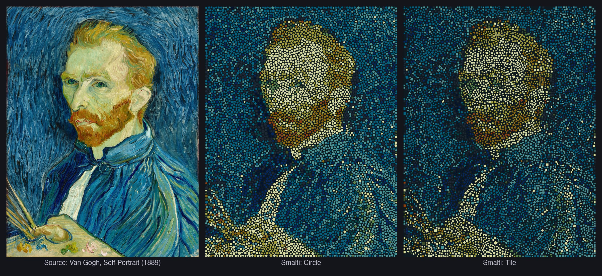

<p align="center"><i>Vincent van Gogh's 1889 self-portrait, rebuilt from about 7,400 dots in a 12-color palette on a dark canvas (0.2–1.0 cm dots).<br>Render modes shown: Circle, Airbrush, Polygon and Tile.</i></p>

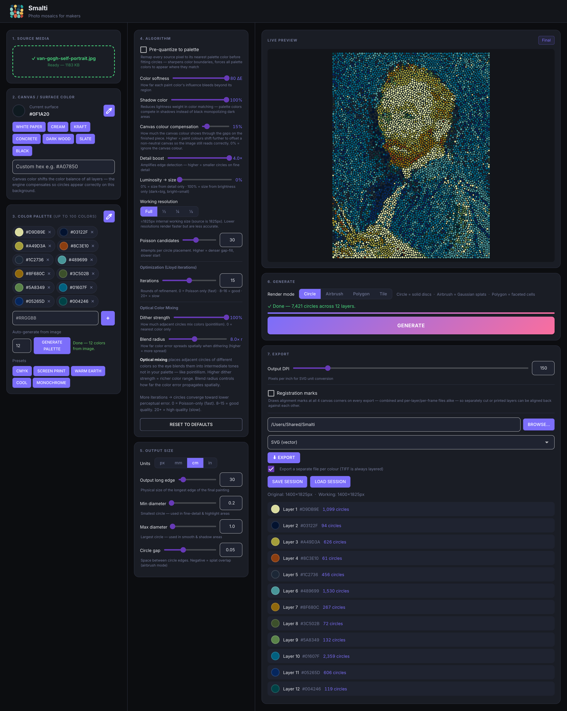

## What it does

- **Four render modes** from the same placement: **Circle** (solid discs), **Airbrush** (soft Gaussian splats),
  **Polygon** (faceted Voronoi cells), and **Tile** (rotated square tesserae that follow the image's contours).
- **Detail-adaptive sizing** — dots shrink on fine detail and grow on smooth areas, between a minimum and maximum size you set in real-world units.
- **Your paints, your canvas** — pick a palette (or auto-generate one from the image), choose the surface color, and Smalti compensates for the canvas showing through the gaps.
- **Optical color mixing** — adjacent dots of different colors blend to the eye, so six paints can read as hundreds of tones.
- **Make it physical** — export to **SVG**, **PNG/JPEG/TIFF** (layered), **G-code** and **Plot SVG** for pen plotters, **JSON** for paint robots/CNC, and **3D** (point cloud, solids, Gaussian splats) with a Blender setup script. One file per paint color, with **registration marks** so separate layers line up.
- **Video** — process a clip into an animated mosaic and render it to ProRes 4444 (with alpha), or export every frame as its own SVG/PNG/G-code file for a physical flip-book.
- Runs **fully offline** on your own machine. Your images never leave it.

## Quick start

### Option A — download the app (Apple Silicon Macs)

1. Download **`Smalti-mac.zip`** from the [latest release](https://github.com/timfennell/smalti/releases/latest) and unzip it.
2. **First launch only:** right-click **`Open Smalti (first time).command`** → **Open** → **Open**.
   (Smalti isn't signed by Apple, so macOS blocks a normal double-click the first time. This helper clears that flag and opens the app.)
3. From then on, just double-click **Smalti.app**.

If macOS still refuses, run this in Terminal (drag the app onto the window to fill in the path):

```bash
xattr -dr com.apple.quarantine /path/to/Smalti.app
```

### Option B — run from source

```bash
git clone https://github.com/timfennell/smalti.git
cd smalti
python3 -m venv venv
source venv/bin/activate
pip install -r requirements.txt
python main.py
```

Smalti opens in your browser at <http://localhost:8484>. For its own desktop window instead of a browser tab:

```bash
pip install -r requirements-optional.txt     # adds pywebview (and optional extras)
SMALTI_APP=1 python main.py
```

## Requirements

| | |
|---|---|
| **Operating system** | macOS. Developed and tested on macOS 26 (Apple Silicon). The session **Save/Load** dialogs and **Open in Finder** use macOS-only system calls; the core engine is plain Python and *may* run elsewhere, but Linux and Windows are untested and unsupported. |
| **Prebuilt app** | Apple Silicon (M1 or newer). Intel Macs: run from source (untested). |
| **From source** | Python **3.11 or newer** (tested on 3.11 and 3.14) and the packages in `requirements.txt`. |
| **Memory** | Measured on an Apple M2 Pro (16 GB): the example portrait (1381×1800-pixel working image, 12 colors, 7,400 dots, 15 iterations) peaks at **~1.6 GB** of RAM in Circle mode and **~1.8 GB** in Tile mode (about 2.7–2.9 GB peak memory footprint as macOS reports it). Larger working sizes and video use more. 8 GB should handle typical images (unverified on 8 GB machines). |
| **Speed** | Same job on that M2 Pro: **~35 seconds** in Circle mode and **~45 seconds** with the Tile layout (timed from the pipeline, excluding the ~10 s of start-up). Time grows with image size, dot count and iterations. |
| **GPU (optional)** | When running from source, installing PyTorch (`requirements-optional.txt`) lets the optimizer use Apple's Metal (MPS) GPU for one of its steps. The prebuilt app leaves PyTorch out to stay small, so it is CPU-only. (The timings above were measured with the GPU step active; expect the prebuilt app to be somewhat slower.) |
| **Disk** | The app is ~540 MB unpacked (~505 MB zip). Exports vary with image size and format. |
| **FFmpeg (optional)** | Needed only for ProRes 4444 `.mov` video export. The prebuilt app bundles it. From source: `brew install ffmpeg`. Without it, video export falls back to an H.264 `.mp4` (or a PNG sequence when transparent). |

## A quick tour

> **Try it right now:** drop [`examples/van-gogh-self-portrait.jpg`](examples/van-gogh-self-portrait.jpg) onto **1. Source media**, click **Generate palette**, then **Generate**.

Smalti's window is three columns. The left holds your inputs, the middle the algorithm and size,
and the right shows the live preview with the generate and export controls.

### 1. Source media

Drop an image or video onto the drop zone (or click it to browse). JPEG, PNG, TIFF, HEIC/HEIF and common video
formats work. Loading a video switches Smalti to video mode (see [Video](#video)).

### 2. Canvas / surface color

The color of the surface you'll make this on. Pick a preset — white paper, cream, kraft, concrete, dark wood, slate, black —
type any hex color, or use the eyedropper to sample it from the image. The eyedropper opens your source image full-screen with a magnifier: scroll to zoom, drag to pan, click to sample (for a video, step through frames to pick one). The canvas shows through the gaps between dots, so Smalti
shifts your paint colors to compensate (tune this with **Canvas colour compensation**).

### 3. Color palette

Up to 100 colors — the paints you actually have. Add colors by hex or eyedropper, remove them with ×, load a
preset (CMYK, screen print, warm earth, cool, monochrome), or let Smalti **auto-generate** a palette of N colors from your image.

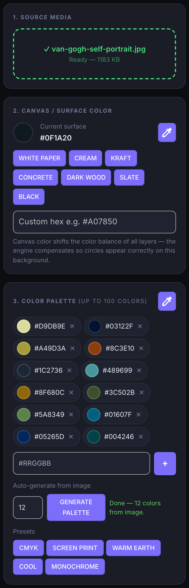

### 4. Algorithm

These sliders shape *where* dots go and *what color* they are:

| Control | What it does |
|---|---|
| **Pre-quantize to palette** | Snaps every source pixel to its nearest palette color first — sharper color boundaries, and every palette color is forced to appear. |
| **Color softness** | How far each paint color's influence bleeds beyond its own region. |
| **Shadow color** | Lowers the weight of lightness in color matching so palette colors compete in shadows instead of black taking over. |
| **Canvas colour compensation** | How much to offset your paints for the canvas color showing through the gaps. 0% ignores it. |
| **Detail boost** | Amplifies edge detection — higher means smaller dots on fine detail. |
| **Luminosity → size** | 0% sizes dots by detail only; 100% sizes them by brightness (dark = big, bright = small). |
| **Working resolution** | Full / ½ / ¼ / ⅛ of the source. Lower is faster but less accurate. |
| **Poisson candidates** | Attempts per dot placement. Higher packs denser but starts slower. |
| **Iterations** | Rounds of Lloyd refinement. 0 = Poisson placement only (fast); 8–16 is good; 20+ is slow. |
| **Dither strength / Blend radius** | *Optical color mixing:* how strongly and how far adjacent dots mix colors so the eye blends them into tones outside your palette. |

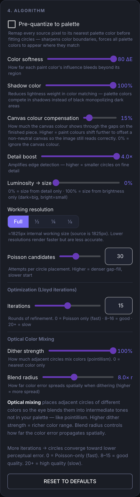

### 5. Output size

Set the real-world size of the finished piece. Choose units (**px, mm, cm, in**), the **Output long edge**, and the
**Min / Max diameter** of dots (small dots go on detail and highlights, large dots on smooth areas and shadows),
plus the **Circle gap** between them (negative values overlap, for airbrush splats).

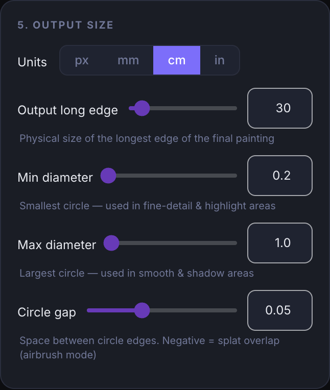

### 6. Generate and render modes

The **Render mode** switch lives in the **6. Generate** card. Generate once, then flip between modes — Smalti builds the geometry each mode needs on demand.

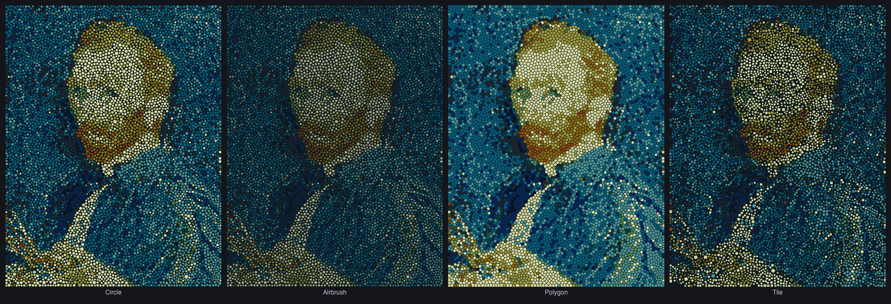

| Mode | Look | Options |
|---|---|---|
| **Circle** | Solid discs. | — |
| **Airbrush** | Soft Gaussian splats that blend into each other. | **Blob size EQ** — a five-band equalizer (XS → XL) that scales splat softness by dot size. |
| **Polygon** | Faceted Voronoi cells, like stained glass. | **Cell outline ratio** (gap between cells), **Curve smoothing** (0 = hard facets → 1 = smooth blobs), **Color gradients** (blend neighbors across each cell). |
| **Tile** | Rotated square tesserae that follow the contours of the image, packed with no overlap. | **Cell outline ratio** (grout gap), **Curve smoothing**. |

Tile mode places tiles with a Centroidal Voronoi Diagram under a locally rotated Manhattan metric,
after Alejo Hausner's *"Simulating Decorative Mosaics"* (SIGGRAPH 2001). Its layout is computed at full resolution so the preview
matches your exports exactly — expect it to take noticeably longer than the other modes on large images.

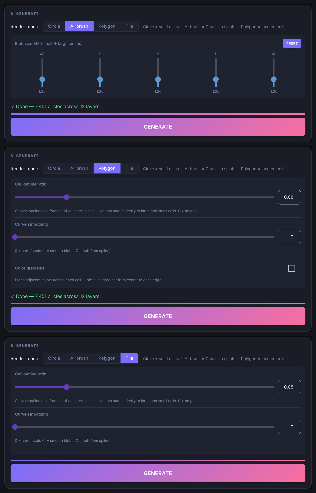

### Generate, then explore

Press **Generate**. Dots appear live as the optimizer refines them. **Scroll to zoom, drag to pan, double-click to reset.**
**Cancel** stops a run. Mode switching is locked while a run is in progress.

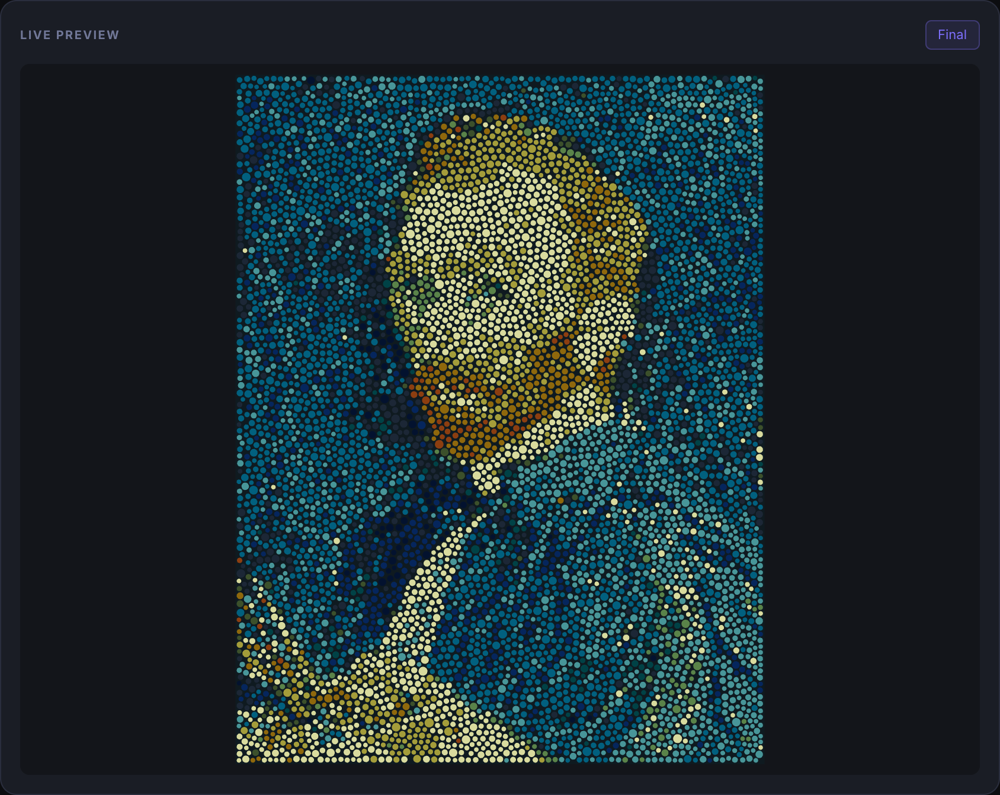

### 7. Export

Pick a format, set the options that apply to it, and press **Export**. Files land in the output folder shown above the format
menu (change it with **Browse…**).

| Format | Use it for |
|---|---|
| **SVG** (vector) | Print, cutting, editing in Illustrator/Inkscape. One file per paint color plus a combined file. |
| **PNG / JPEG** | Flat raster at any long-edge pixel size. |
| **TIFF** (layered, LZW) | An opaque canvas base plus one transparent layer per color, for Photoshop-style editing. |
| **G-code** (pen plotter) | One file per color — swap pens between files. Each shape is a single pen-down spiral stroke, so the plotter never lifts mid-shape. Choose the **G-code origin** and **pen tip width**. |
| **Plot SVG** | The same spiral geometry as G-code, as a stroke-only SVG for plotter software that imports SVG. |
| **JSON** (paint robot / CNC) | Positions, sizes and colors, ordered in spaced **paint passes** so wet neighbors aren't revisited. |
| **3D** — point cloud (PLY + CSV), cell solids (OBJ + MTL), Gaussian splats (PLY) | Blender and other 3D tools. A Blender setup script is written alongside. |

G-code, Plot SVG, SVG and raster exports all work in Circle, Polygon and Tile modes (Airbrush has no outline to fill).

**Registration marks.** Tick **Registration marks** to draw alignment marks at all four corners of every 2D export — circles, crosses, or corner ticks.
A **positive distance puts them outside the artwork** (the canvas is enlarged to fit); a negative distance pulls them inside. On per-color files the marks
are drawn in that file's own color, and on the combined file in white on a dark canvas (black on a light one, so they stay visible), so separately cut or printed layers can be lined up exactly.

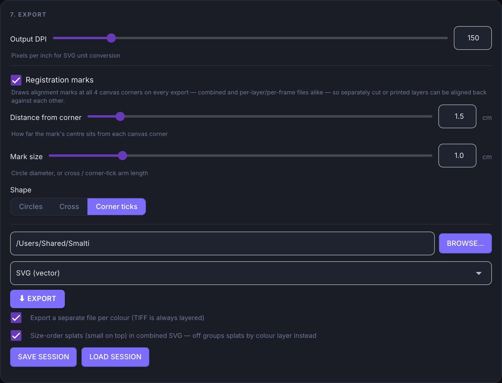

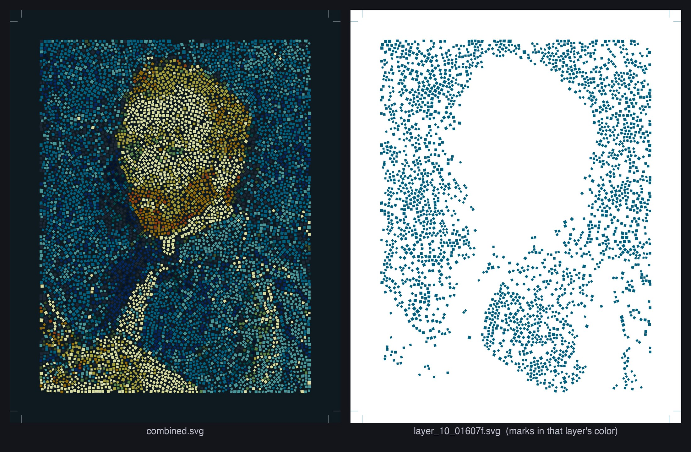

### Save and load sessions

**Save session** writes a `.smalti.json` file with your settings, palette, source image and result, so you can pick up later without regenerating.
**Load session** restores it. Because a session embeds the source image, treat session files like the image itself.

### Video

Drop a video onto **Source media** and a **Video options** card appears (the Generate and Export cards are renumbered to match):

| Control | What it does |
|---|---|
| **Fresh dots each frame** | On: every frame is optimized independently (always matches that frame's detail; more flicker, slower). Off: each frame warm-starts from the last (smoother, but arrangements can persist). |
| **Iterations · per frame** | Optimization rounds per frame. |
| **Frame stride** | Process every Nth frame (2 halves the work and the output fps). |
| **Max frames** | Cap the frame count — set it low to preview the look first. |

Press **Process video**, then scrub or **Play** to review. Render modes apply to video too; scrubbing in Polygon and Tile
renders each frame on demand, so Tile is much slower to scrub than Circle. Then either:

- **Render video** — ProRes 4444 `.mov` (or H.264 `.mp4` without FFmpeg), optionally with a transparent background, choosing which colors to include; or
- **Export frame sequence** — every frame as its own SVG, PNG, JPEG, TIFF, G-code or Plot SVG file in a numbered folder.

Note that Tile mode lays out each frame independently, so tiles will flicker from frame to frame rather than tracking smoothly.

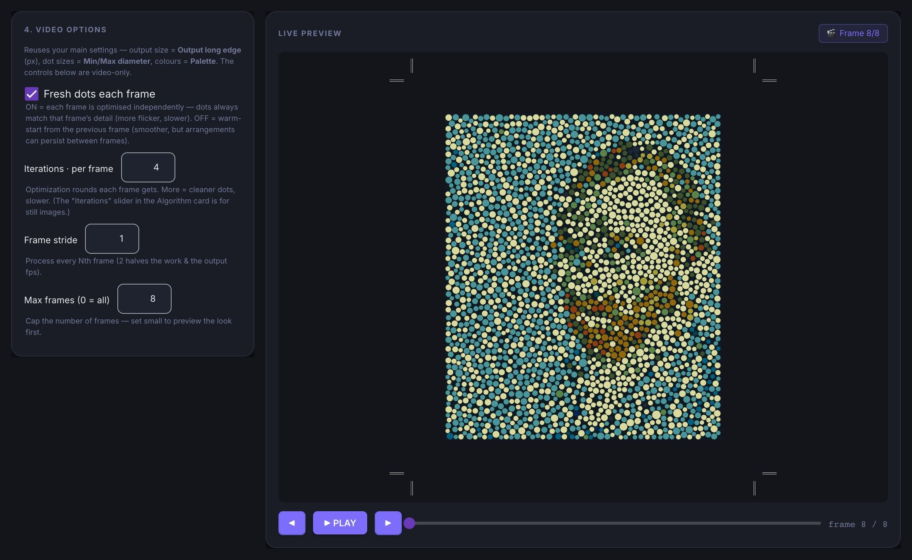

## Troubleshooting

- **"Smalti can't be opened" / "unidentified developer"** — use the first-launch steps above; the app is unsigned.
- **Port 8484 already in use (from source)** — another copy of Smalti (or something else) is using it. Quit it and relaunch.
- **Tile mode is slow** — Tile computes its layout at full export resolution. Lower **Working resolution** (½ or ¼) to iterate faster, then go to Full for the final.
- **Something went wrong in the packaged app** — it writes a log to `~/Library/Logs/Smalti/smalti.log`. Attach it when you file an issue.

## Building the app yourself

```bash
python3 -m venv venv
venv/bin/pip install -r requirements.txt -r requirements-optional.txt
brew install ffmpeg            # optional — bundles ffmpeg for ProRes video export
./build_app.sh                 # → dist/Smalti.app
./build_release_zip.sh         # → dist/Smalti-mac.zip, with the first-launch helper
```

The app is unsigned. To distribute a signed/notarized build you'll need your own Apple Developer ID.

## Project layout

```
main.py                 NiceGUI app: UI, state, preview, export wiring
core/
  pipeline.py           End-to-end run: load → place → optimize → result
  optimizer.py          Lloyd refinement, densify/prune, Voronoi/tile helpers
  tile_cvd.py           Tile mode (CVD under a rotated Manhattan metric)
  svg_writer.py  raster_export.py  gcode_export.py  plot_svg_export.py
  cnc_export.py  model3d_export.py  registration_marks.py
  video_mosaic.py  video_render.py  video_sequence_export.py
assets/                 Icons and the vendored PixiJS used by the live preview
examples/               Public-domain example image
```

## License

Smalti is released under the [MIT License](LICENSE). It builds on other open-source projects; see
[THIRD_PARTY_NOTICES.md](THIRD_PARTY_NOTICES.md) — including the GPL-licensed FFmpeg binary bundled in the prebuilt app, which is not covered by the MIT license.

The example painting is in the public domain; see [`examples/README.md`](examples/README.md).

## Contributing

Bug reports and pull requests are welcome — please open an [issue](https://github.com/timfennell/smalti/issues) first for anything large.
